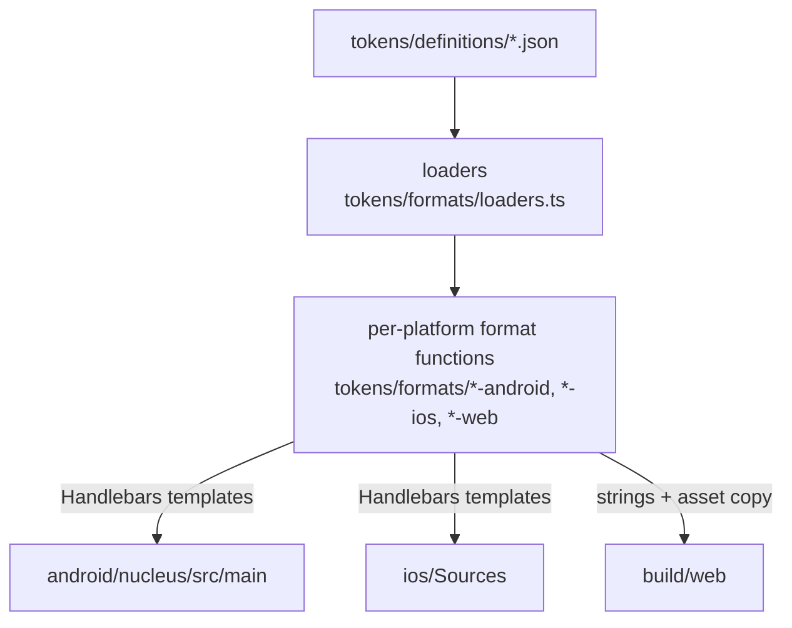

# Contributing to Nucleus

## Architecture

Tokens are authored as JSON in `tokens/definitions/`. A TypeScript build pipeline reads the JSON through a validating loader, runs format-specific generators, and writes platform-native source files into the repo. The generated files are committed; CI verifies they are in sync with the source JSON on every PR.



**Design principles**

- **JSON defines tokens; `fonts/` owns font binaries.** Platform token source is generated from JSON. The TypeScript pipeline stages native font resources from `fonts/`; nothing is hand-edited downstream.
- **Source layers are explicit in token paths.** Color tokens live under `primitive.color.*` and `semantic.color.*`. Font tokens are split into a `families` block (font files) and a `tokens` block (typography styles).
- **Platform outputs are standalone.** No app-specific dependencies. Android gets Compose `Color` / `NucleusFontStyle` values; iOS gets a `NucleusColor` struct and a `NucleusFont` struct; web gets CSS custom properties + JSON.
- **Generated token source and native font resources are committed; web build outputs are ignored.** CI runs `npm run build` then `git diff --exit-code` to ensure the source and generated outputs stay in sync.

## Building

```bash
npm ci
npm run build
```

`npm run build` generates token source, stages native font resources, and builds the web package:

Generated files appear in:

| Platform | Path | Contents |
| --- | --- | --- |
| Android | `android/nucleus/src/main/java/com/worldcoin/nucleus/tokens/` | Kotlin objects (`NucleusPrimitiveColors`, `NucleusSemanticColorsLight`/`Dark`, `NucleusFonts`) shipped in the `android/nucleus` Maven artifact |
| Android | `android/nucleus/src/main/res/font/` | Generated TTF copies staged by the TypeScript build and committed |
| iOS | `ios/Sources/NucleusColors/` | `NucleusColor` struct + generated `NucleusColor+Primitives.swift` and `NucleusColor+Semantics.swift` (SPM library `NucleusColors`) |
| iOS | `ios/Sources/NucleusFonts/` | `NucleusFont` struct + generated `NucleusFont+Defaults.swift` (SPM library `NucleusFonts`) |
| iOS | `ios/Sources/NucleusFonts/Resources/Fonts/` | Generated TTF and license notice copies staged by the TypeScript build and committed |
| Web | `build/web/` | CSS custom properties (`nucleus-*.css`), JSON token files, font files, `package.json` for npm publishing |

The repo-root `VERSION` file is the canonical version. `npm run build` stamps it into the web `package.json`; the Android library reads it from `build.gradle.kts`; SPM consumes the SPM tag.

Run `npm test` for the Android SVG conversion tests. With an Android device or emulator connected,
run `cd android && ./gradlew :nucleus:connectedDebugAndroidTest` to compare every generated icon's
Compose rendering with Android's core path parser. CI runs this on API 30 and 35 because older
Android native paths handle relative moves after closing a contour differently.


## Adding or modifying tokens

1. Edit the relevant JSON file in `tokens/definitions/`. The loader validates the shape at build time and throws a clear error if a field is missing or malformed.
2. Run `npm run build` to regenerate platform sources and verify output.
3. Commit both the source change _and_ the regenerated files (CI enforces this with `git diff --exit-code`).
4. Open a PR with a release label (`patch`, `minor`, or `major`).

For new typography tokens: add the font file to `fonts/`, declare it in the `families` block of `tokens/definitions/font/fonts.json`, then reference it from the token. The Android resource name is derived by snake-casing the filename.

### Font assets and native builds

The `fonts/` directory holds the canonical font binaries. Platform font resources are generated copies; edit only the canonical files. `tokens/definitions/font/fonts.json` declares filenames, the internal PostScript name, and typography tokens. The icon-to-Unicode lookup table lives alongside the font in `fonts/WorldPro_icon_unicode_map.csv`.

World Pro is proprietary and excluded from the repository's MIT license; see [`fonts/LICENSE.md`](fonts/LICENSE.md). The agreement excludes public-repository distribution and public licensing. A notice does not authorize those uses; confirm separate written authorization before publishing font assets publicly. The web build and SwiftPM font bundle include the notice with the font.

- **Android:** `tokens/build/fonts.ts` reads the declared families from `fonts.json` through the existing validating loader, copies each TTF from `fonts/` into `android/nucleus/src/main/res/font/`, and derives its resource name with the shared `snakeCase()` helper (`WorldPro.ttf` → `world_pro.ttf`). Gradle packages these resources normally; it has no additional font-staging task or filename conversion logic. `R.font.world_pro` remains the consumer API.
- **iOS:** The same TypeScript pipeline copies each TTF and the license notice into `ios/Sources/NucleusFonts/Resources/Fonts/`. The existing `NucleusFonts` SwiftPM target processes that directory, and `NucleusFont.registerFonts()` loads the font from `Bundle.module`. There is no separate resource target.
- **Web:** The pipeline copies the declared TTF, optional `webFiles` (WOFF2/WOFF), and license notice into ignored `build/web/fonts/`, so the npm package is self-contained.

For font updates, replace the binaries in `fonts/` and update `postscriptName` in `fonts.json` if the font's internal PostScript name changed. Renaming a file does not change that internal name. When adding or renaming fonts, update the filenames in `fonts.json` and web consumer paths such as `examples/web/app/layout.tsx`; remove obsolete generated font resources after a rename. Run `npm run build` and commit both the canonical changes and regenerated native resources. Do not hand-edit the platform copies.

Verify generation and native packaging from the repository root:

```bash
npm run build
(cd android && ./gradlew :nucleus:assembleRelease)
xcodebuild build -scheme Nucleus-Package -destination 'generic/platform=iOS' -skipPackagePluginValidation
```

Runtime font checks are in `ios/Tests/NucleusFontsTests/FontLoadingTests.swift` and `android/nucleus/src/androidTest/java/com/worldcoin/nucleus/FontLoadingTest.kt`. The iOS tests verify registration without system-font fallback, variable weights 300/500/800, and the U+E000 icon glyph. The Android test loads the generated resource and checks the same icon glyph; the existing emulator CI job runs it alongside the icon rendering tests.

```bash
# Choose an installed iPhone simulator; list choices with xcrun simctl list devices available.
xcodebuild test -scheme Nucleus-Package \
  -destination 'platform=iOS Simulator,name=iPhone 17 Pro,OS=latest' \
  -only-testing:NucleusFontsTests

# Requires a connected Android device or running emulator.
(cd android && ./gradlew -Dorg.gradle.jvmargs=-Xmx3g --max-workers=2 \
  :nucleus:connectedDebugAndroidTest \
  -Pandroid.testInstrumentationRunnerArguments.class=com.worldcoin.nucleus.FontLoadingTest)
```

Native CI jobs and package consumers build directly from the committed generated resources. The token CI job reruns `npm run build` and checks the diff to keep those resources in sync with the canonical assets.

## CI

The verification workflow (`.github/workflows/verify.yml`) runs `format:check`, `lint`, `typecheck`, `build`, and the codegen-in-sync check on every push to `main` and every PR.

## Releases

Release automation is split across two workflows:

- `.github/workflows/prepare-release.yml` — prepares release PRs
- `.github/workflows/publish-release.yml` — tags and publishes merged release PRs

The prepare workflow runs in two modes:

- **Push to `main`** after merging a PR with a release label (`major`, `minor`, `patch`) — the workflow derives the bump from the merged PR, creates a `release/v*` branch, and opens a release PR.
- **Manual dispatch** — choose the bump type from the Actions UI to create the same release PR flow without a source PR label.

If the computed tag already exists, `prepare-release.yml` skips instead of opening a duplicate.

### Pipeline steps

1. **Release PR creation** — `prepare-release.yml` determines the next version, updates `VERSION`, `package.json`, `package-lock.json`, and `CHANGELOG.md`, then opens a `release/v*` PR.
2. **Release PR merge** — merging that PR back into `main` triggers `publish-release.yml`.
3. **Tag + build** — the merged release commit is tagged as `v*`, then `npm run build` runs and uploads `web-tokens`.
4. **publish-mvn** — the TypeScript build stages font resources, and Gradle publishes the Android library to GitHub Packages.
5. **SPM** — consumers use the tagged repository (`v*`); SwiftPM builds token source and bundles the generated native font resources. There is no separate SPM publishing job in the current workflow.
6. **publish-npm** / **publish-gh-packages** — two independent jobs publish the web package (`@worldcoin/nucleus`): the primary to the public npm registry through trusted publishing and a backup mirror to GitHub Packages. One failing doesn't block the other.

`publish-release.yml` only publishes the first time it creates the `v*` tag. Reruns after that tag exists skip the publish jobs.

## Example apps

- `examples/android/` — Android demo with `local` and `package` flavors
- `examples/ios/` — iOS demo with `Local` and `Package` schemes
- `examples/web/` — Next.js demo with `local` and `package` token sources
